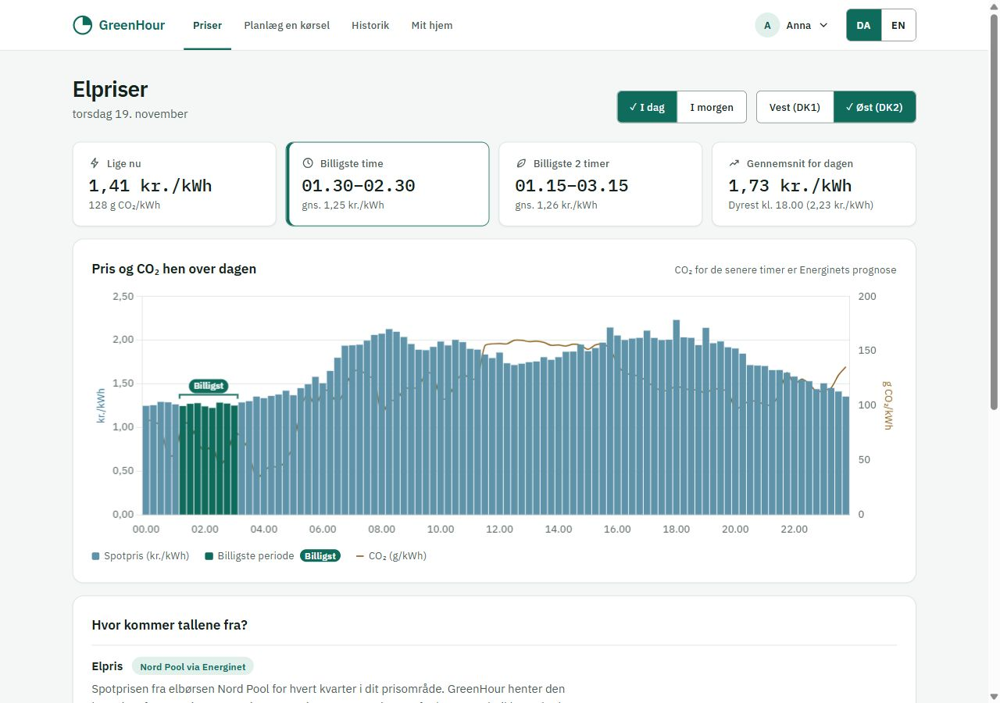
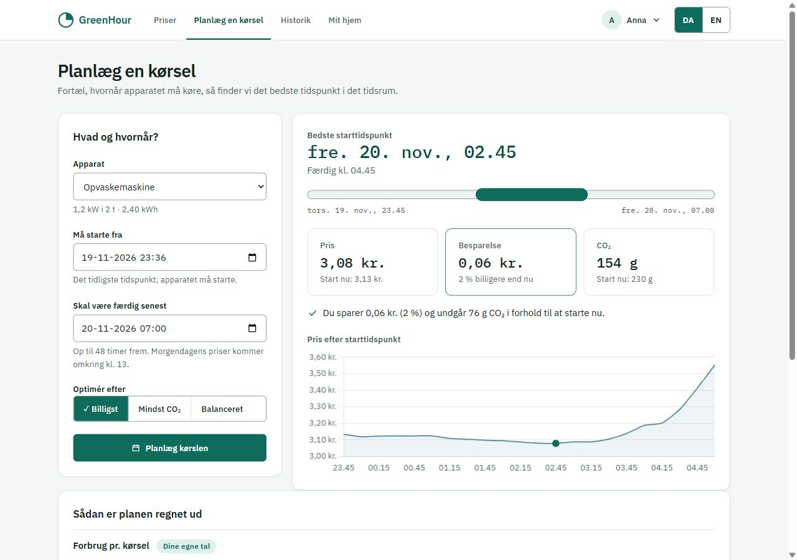
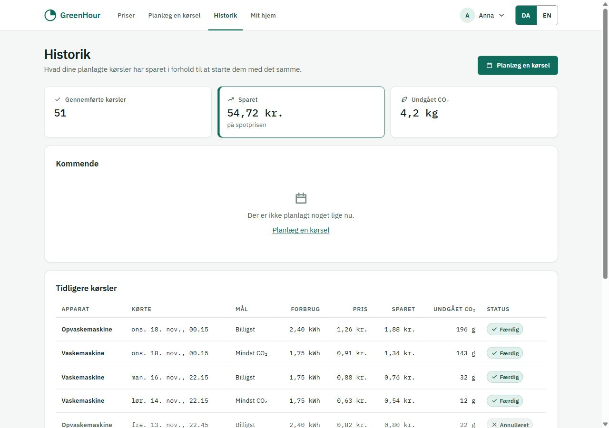

# GreenHour

[](https://github.com/HamsaALT/greenhour/actions/workflows/ci.yml)

Danish electricity prices change every 15 minutes, and so does how much CO₂ is
emitted per kWh. A dishwasher started at 18:00 can easily cost twice as much as
the same run at 02:00, but nobody checks the spot price before pressing start.

GreenHour does it for you. You tell it which appliance you want to run and when
it has to be done, and it finds the cheapest (or cleanest) start time using
live data from Energinet's [Energi Data Service](https://www.energidataservice.dk).
Every run is compared against just starting right away, so you can see what the
habit is actually worth over time.

## Screenshots

**Prices.** Key figures for the day and a chart of price and CO₂ per quarter hour,
with the cheapest two hours marked and labelled.



| Plan a run | History |
|---|---|
|  |  |
| The best start time on a timeline of your window, with cost, saving and CO₂ next to starting right away. | Totals at the top, upcoming runs and past runs with their status. |

## Features

- Today's and tomorrow's day-ahead prices for DK1 (west) and DK2 (east) in
  15-minute resolution, with CO₂ intensity on top.
- Summary cards for the current price, the cheapest hour, the cheapest two hours
  and the day's average. The cheapest period is labelled in the chart, not only
  coloured.
- Appliances with power and run time. Typical values are filled in for common types.
- Planning that optimises for price, CO₂ or a balance of both, inside a window
  of up to 48 hours. The form checks the window as you type (deadline after the
  start, long enough for the appliance, at most 48 hours ahead) and the result
  shows the start time on a timeline with cost, saving and CO₂.
- A history of runs with money saved and CO₂ avoided. Long histories are shown
  ten runs at a time.
- Responsive layout: tables turn into stacked cards on phones and tablets, so no
  page scrolls sideways. On small screens the navigation moves into a menu.
- Skeleton placeholders while data loads, and error states with a retry button.
- Confirmation before destructive actions: deleting an appliance, cancelling a
  planned run and running a market data import.
- The app renders straight away and signs in with Keycloak in the background. If
  Keycloak doesn't answer within 2.5 seconds, the public prices page is shown to a
  guest, and sign-in state follows when Keycloak responds.
- Hourly import from Energi Data Service, with back-off when the API rate-limits.
- Admin page to trigger a backfill.
- Power BI report on top of dedicated SQL views ([guide](docs/power-bi.md)).

## Data sources

Every number in the app says where it comes from, in a "Where do the numbers come
from?" panel on the prices and planning pages.

| Figure | Source | Data set |
|---|---|---|
| Electricity price | Nord Pool day-ahead spot price, published by Energinet | [`DayAheadPrices`](https://www.energidataservice.dk/tso-electricity/DayAheadPrices) |
| CO₂ per kWh, measured | Energinet | [`CO2Emis`](https://www.energidataservice.dk/tso-electricity/CO2Emis) |
| CO₂ per kWh, rest of today | Energinet forecast | [`CO2EmisProg`](https://www.energidataservice.dk/tso-electricity/CO2EmisProg) |
| Appliance power and run time | Entered by the user; presets are GreenHour's own typical figures | – |
| Best start time and saving | Calculated by GreenHour | – |

Energi Data Service is open and needs no API key. GreenHour isn't affiliated with
Energinet, and the plans are suggestions, not advice.

## Languages

The interface is in **Danish by default**, with **English** available from the
DA / EN switcher in the top-right corner of every page. The choice is remembered
in the browser, and a first visit always starts in Danish, whatever the browser's
own language is.

- Texts live in `frontend/src/i18n/da.json` and `en.json` and are loaded with
  [ngx-translate](https://github.com/ngx-translate/core). A test checks that both
  files have exactly the same keys and placeholders.
- Dates, numbers and amounts follow the chosen language: `1.234,50 kr.` and
  `onsdag den 18. november` in Danish, `DKK 1,234.50` and `Wednesday 18 November`
  in English. Times are always Danish time.
- `<html lang>` and the page title change with the language, and the Keycloak
  login page opens in the same language.
- The API and the database stay in English. Error responses carry a stable `code`
  (for example `PRICES_NOT_PUBLISHED`) that the app turns into a message in the
  user's language.

## Accessibility

The frontend aims at WCAG 2.2 AA.

- Semantic HTML: landmarks, headings in order, real buttons and links, table
  headers with `scope`, and every form field has a visible label. Hints and
  validation messages are linked to their fields with `aria-describedby`, and
  invalid fields set `aria-invalid`.
- Colours come from design tokens in `frontend/src/styles.css`, chosen for at least
  4.5:1 contrast for text and 3:1 for borders and other UI parts. Colour is never
  the only signal: statuses, selected options and the cheapest period in the chart
  also carry an icon or a text label.
- Keyboard: a skip link to the main content, a visible focus ring on every control,
  and menus that close with Escape and return focus to their button.
- Touch targets in the header and mobile menu are at least 44 × 44 px.
- Charts have a text summary for screen readers, and loading and status messages
  are announced through live regions.
- Animations are turned off when the system asks for reduced motion.

## Tech stack

| Area | Technology |
|---|---|
| Backend | Java 21, Spring Boot 3.5, Spring Web, Spring Data JPA, Bean Validation, Actuator, springdoc OpenAPI |
| Security | Spring Security as an OAuth2 resource server (JWT), Keycloak as identity provider |
| Database | PostgreSQL 16 with Flyway migrations |
| Frontend | Angular 22 (standalone components, signals), RxJS, ngx-translate, Chart.js, keycloak-js |
| Testing | JUnit 5, Spring Boot Test, Spring Security Test, Testcontainers, JaCoCo, Vitest + jsdom |
| Tooling | Maven, Angular CLI, Prettier, Docker Compose, GitHub Actions |
| Reporting | Power BI |

## Getting started

You need [Docker Desktop](https://www.docker.com/products/docker-desktop/). That's all for the quick start.

```bash
git clone https://github.com/HamsaALT/greenhour.git
cd greenhour
docker compose up --build
```

The first build takes a few minutes. Wait until `docker compose ps` shows all
services as healthy, then open **http://localhost:4200**. (With `docker compose up -d --wait`
the command itself returns once every service is healthy.)

Demo users (password `demo` for all):

| User | What you'll see |
|---|---|
| `anna` | Apartment in Copenhagen (DK2) with a dishwasher and washing machine, and two months of history |
| `jonas` | House in Aarhus (DK1) with an EV, so the savings are much larger |
| `admin` | Can also open the admin page and trigger a market data import |

You can also click **Create account** to register a new user.

| Service | URL |
|---|---|
| Web app | http://localhost:4200 |
| API docs (Swagger UI) | http://localhost:8080/swagger-ui.html |
| Health check | http://localhost:8080/actuator/health |
| Keycloak admin console | http://localhost:8081 (admin / admin) |
| PostgreSQL | localhost:5433, database `greenhour` |

To stop everything, run `docker compose down`. Add `-v` to also delete the database.

### Running without the internet

The importer needs internet access to reach Energi Data Service. Without it the
app still works on the generated demo data, and the prices page shows a notice
saying so. To switch the importer off completely:

```bash
MARKET_IMPORT_ENABLED=false docker compose up          # bash / zsh
$env:MARKET_IMPORT_ENABLED="false"; docker compose up  # PowerShell
```

## Development

Run the database and Keycloak in Docker, and the backend and frontend locally
so you get hot reload.

```bash
docker compose up -d postgres keycloak
```

Backend (JDK 21 or newer, Maven is downloaded by the wrapper):

```bash
cd backend
./mvnw spring-boot:run        # on Windows: mvnw.cmd spring-boot:run
```

Frontend (Node 24):

```bash
cd frontend
npm ci
npm start
```

The Angular dev server runs on http://localhost:4200 and proxies `/api` to the
backend on port 8080.

### Tests

```bash
cd backend
./mvnw verify          # unit tests, integration tests and the coverage check
```

Integration tests (`*IT.java`) start a real PostgreSQL 16 with Testcontainers, so
Docker has to be running. They run through Maven Failsafe after the unit tests. The
build fails if line coverage drops below 80%, and the report ends up in
`backend/target/site/jacoco/index.html`.

```bash
cd frontend
npm run test:ci        # Vitest with jsdom
npm run format:check   # Prettier
npx tsc -p tsconfig.app.json --noEmit   # type check
npm run build          # production build
```

## How it works

```
Browser (Angular) ──► nginx ──► Spring Boot API ──► PostgreSQL
      │                               │                 ▲
      └──── login (OIDC + PKCE) ──► Keycloak            │
                                      │                 │
              Energi Data Service ◄───┘  hourly import ─┘
```

**Market data.** Every hour the backend fetches day-ahead prices
(`DayAheadPrices`), measured CO₂ (`CO2Emis`) and forecast CO₂ (`CO2EmisProg`)
for both price areas. CO₂ arrives in 5-minute steps and is averaged into the
15-minute price slots. Measured values always replace forecasts. The HTTP calls
happen outside the database transaction, so a slow or rate-limited API never
holds a connection.

**Planning.** Every 15-minute boundary inside the window is a possible start
time. For each one the backend adds up price × power for the slots the run would
cover and keeps the best one. A window is at most 48 hours and a run at most 12,
so that's a few thousand additions, and simple enough to trust and test. The
"Balanced" goal scales price and CO₂ to 0–1 across the options and averages them.
The result is always compared with starting as early as allowed, and that difference
is the saving.

**Time zones.** Everything is stored in UTC and shown in Danish time. "Today"
always means today in Denmark, and DST days correctly have 23 or 25 hours (there
are tests for both).

**Security.** The frontend logs in against Keycloak with the authorization code flow
and PKCE, and sends the access token as a bearer token. The backend validates the
token and maps Keycloak realm roles to Spring roles. Users only ever see their own
household. Asking for someone else's appliance or run returns 404 rather than 403,
so ids can't be probed.

### Database migrations

| Migration | Contents |
|---|---|
| `V1__schema.sql` | Tables, constraints and indexes |
| `V2__demo_data.sql` | Demo households and appliances, about 60 days of generated market data, and a history of runs planned with the same rules as the app |
| `V3__report_views.sql` | Reporting views and the read-only `powerbi_reader` role |
| `V4__danish_demo_names.sql` | Danish names for the demo households and appliances |

### API overview

| Method | Path | Auth |
|---|---|---|
| GET | `/api/market?area=DK2&date=2026-11-18` | public |
| GET / PUT | `/api/household` | user |
| GET / POST / PUT / DELETE | `/api/appliances` | user |
| POST | `/api/runs/preview` | user |
| GET / POST | `/api/runs` | user |
| PATCH | `/api/runs/{id}` | user |
| GET | `/api/runs/summary` | user |
| GET / POST | `/api/admin/market-import` | admin |

The full contract is in Swagger UI. Errors use the RFC 9457 problem format.

## Limitations

- Prices are spot prices only. Grid tariffs, taxes and VAT are left out because
  they depend on the user's grid company, so the amounts are lower than on an
  electricity bill. Most Danish grid companies charge their highest tariff between
  17:00 and 21:00, so moving usage out of those hours usually saves *more* than the
  app shows. Adding tariffs per grid company is the obvious next step.
- Appliances are modelled with a flat power draw for their whole run time. The
  presets for each appliance type are typical figures I picked, not official ones,
  and the app labels them that way.
- Energinet only forecasts CO₂ to the end of the current day, so CO₂-based plans
  can't look into tomorrow yet. The app tells the user when this limits a plan.

## License

[MIT](LICENSE)

## Author

**Hamsa Hassan** – [LinkedIn](https://www.linkedin.com/in/hamsa-hassan-85b3a3378/)
